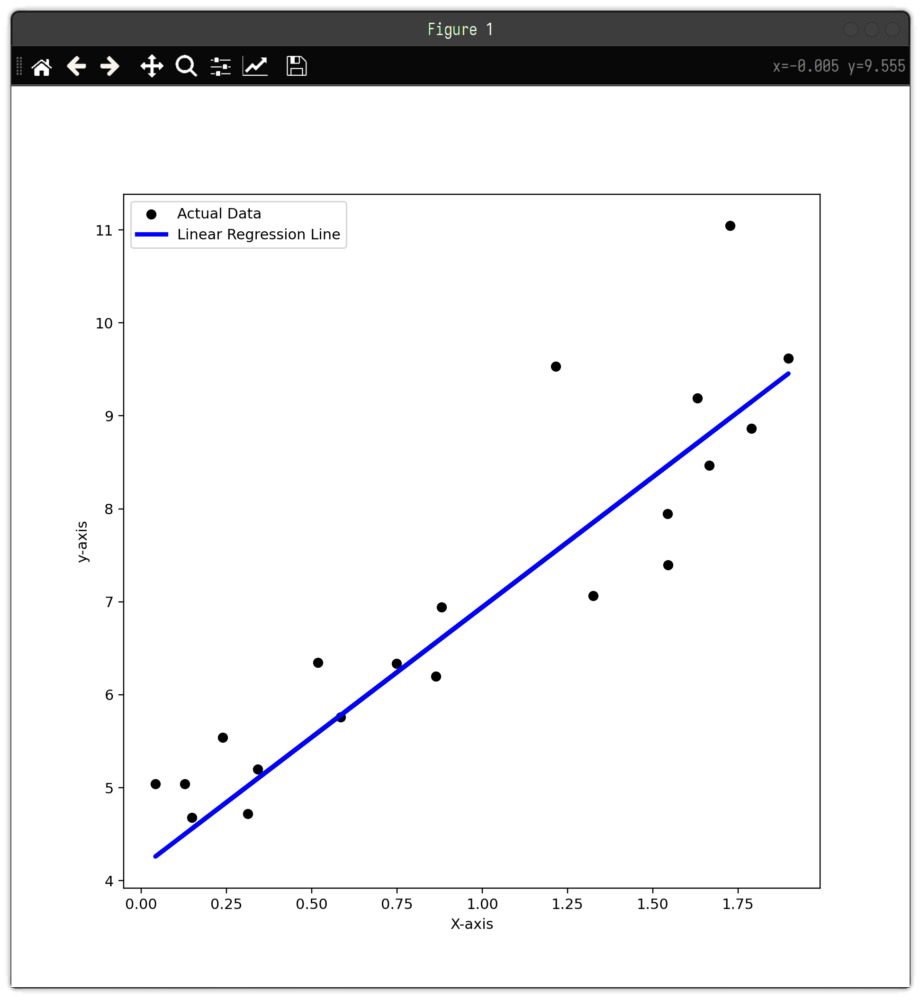

# Linear-Regression

Started leanring ML and its one of the mst basic but imporatnt steps to undersatnd and implement Linear regression.
linear regression is a linear approach for modelling a predictive relationship between a scalar response and one or more explanatory variables (also known as dependent and independent variables), which are measured without error.
 
 
