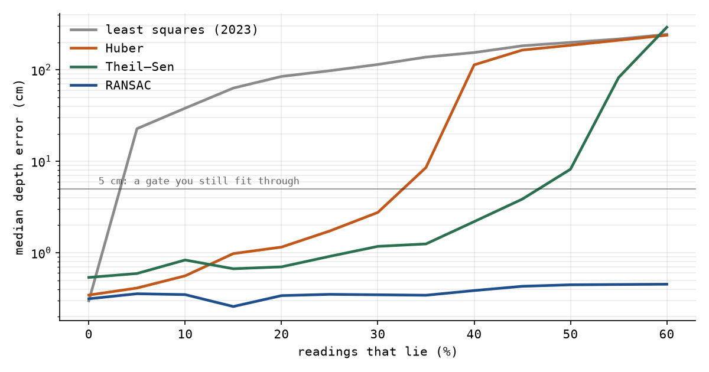
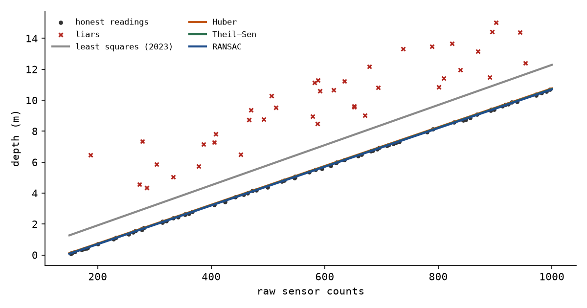

# trust-issues

**A straight line, a depth sensor, and the fraction of liars it can survive.**

My first machine-learning script (November 2023) fit a line through
100 polite, made-up points with ordinary least squares. Least squares is a
wonderful listener. It weighs every point equally, including the ones that
are lying.

On a robot, points lie all the time. The pressure sensor that tells an
underwater vehicle its depth is calibrated by fitting exactly this kind of
line, raw counts → metres, and the calibration data comes with bubbles on
the port, cable tugs and the occasional bit-flip on the bus. So the question
became: **what fraction of the data can lie before the depth estimate is
useless?** Statisticians call that the *breakdown point*.



## The interrogation

Each trial is a 120-reading calibration run. A growing fraction of readings
gets a spike of +2 to +6 m. Four estimators fit the line; the score is the
mean depth error across the sensor's working range, median over 40 trials.

| liars | least squares | Huber | Theil–Sen | RANSAC |
|---:|---:|---:|---:|---:|
| 0 % | 0.3 cm | 0.3 cm | 0.5 cm | 0.3 cm |
| 5 % | 22.7 cm | 0.4 cm | 0.6 cm | 0.4 cm |
| 20 % | 84.7 cm | 1.2 cm | 0.7 cm | 0.3 cm |
| 35 % | 137.9 cm | 8.6 cm | 1.2 cm | 0.3 cm |
| 50 % | 199.5 cm | 185.7 cm | 8.2 cm | 0.4 cm |
| 60 % | 244.3 cm | 239.3 cm | 292.3 cm | 0.5 cm |
| **under 5 cm until** | **0 %** | **30 %** | **45 %** | **60 %+** |

Here is one of those runs at 30 % liars. Least squares splits the difference
between the truth and the lies; the other three ignore the shouting.



## Verdicts

- **Least squares** breaks with *one* liar; its breakdown point is 0 %.
  Five percent of bad readings put the vehicle 23 cm off in depth.
- **Huber** bends instead of breaking, and is cheap enough for a
  microcontroller. It collapses abruptly between 35 and 40 %.
- **Theil–Sen** takes the median of pairwise slopes. Its theoretical
  breakdown is ~29 % but it holds longer here, because these liars scatter
  rather than agree.
- **RANSAC** wins this round, and the reason is worth knowing: it trusts the
  largest group that *agrees*. These liars disagree with each other, so they
  never outvote the truth. Liars that conspire (a sensor that drifts
  consistently) would beat it. No estimator survives an organised lie. That's
  what a second, independent sensor is for.

## Run it

```bash
python -m venv .venv && . .venv/bin/activate
pip install -r requirements.txt
python -m trustissues.run     # ~50 s, prints the table, rewrites assets/*.png
```

Seeded and deterministic.

## Layout

```
origin/Main.py         the 2023 script: OLS on 100 well-behaved points
trustissues/run.py     the sweep, the trial, both figures
```
